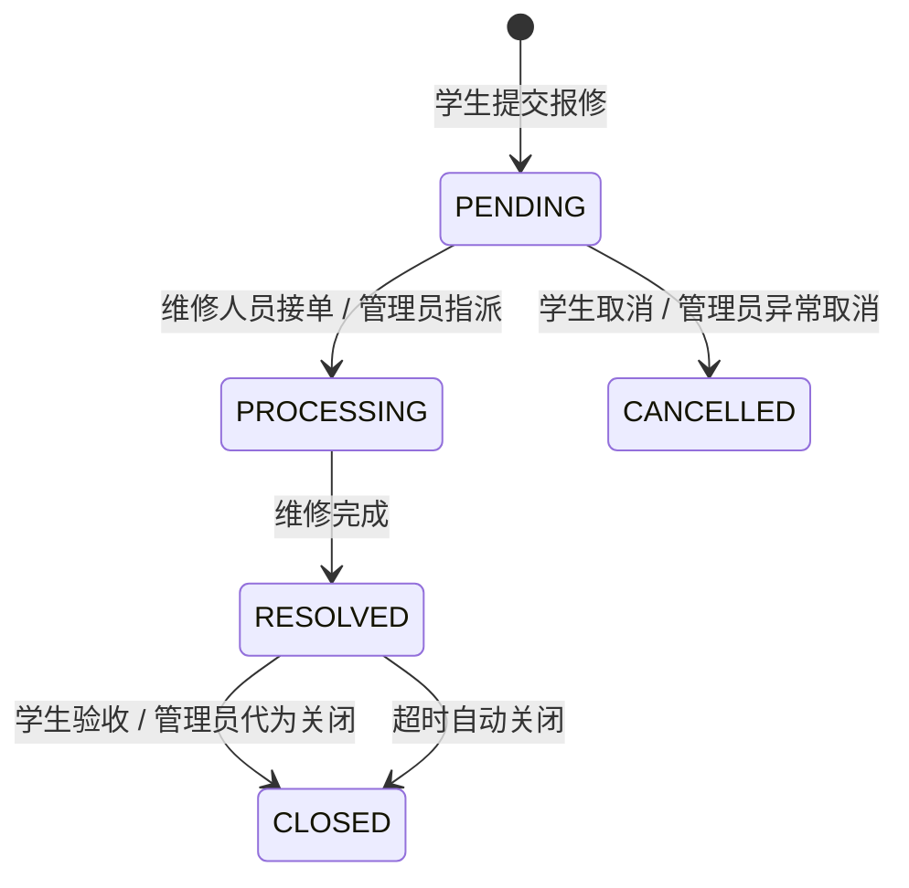

# 校园报修协作系统

基于 FastAPI 与 React 的前后端分离工单协同系统，实现“学生报修 → 维修接单 / 管理员指派 → 维修完成 → 学生验收关闭”的完整生命周期。

[](https://www.python.org/)
[](https://fastapi.tiangolo.com/)
[](https://www.mysql.com/)
[](https://react.dev/)

## 项目概览

校园后勤报修涉及学生、维修人员和管理员三类角色，传统沟通方式容易出现进度不透明、重复接单、越权操作和超时积压等问题。本项目以工单状态机为核心，提供角色数据隔离、操作审计、统计看板和超时自动关闭能力。

本仓库整合了团队项目的后端与维修端前端：

- `backend/`：FastAPI + SQLAlchemy Async + MySQL，本人负责的接口、状态机、并发控制与定时任务。
- `frontend/`：Vite + React + Ant Design，团队协作完成，用于登录、工单池、维修处理、管理指派与统计看板。
- `docs/`：PRD、OpenAPI 契约、状态迁移 ADR、前后端联调说明和学生端交互原型。

## 核心能力

- **角色隔离**：学生仅查看本人工单，维修人员仅查看工单池与本人任务，管理员拥有全局视图。
- **并发安全状态机**：通过条件更新与影响行数判定实现 5 状态、7 动作迁移，重复受理统一返回 `409`。
- **完整操作链路**：接单、处理、留言、完成、验收、取消、管理员指派与异常状态处理。
- **可追溯审计**：每次状态迁移和关键操作写入日志，可按工单查看完整时间线。
- **超时自动关闭**：APScheduler 每日检查超过 48 小时未验收的工单并自动确认完成。
- **契约先行**：在 `docs/openapi.yaml` 中维护接口契约，并以契约测试约束实现。

## 状态机



关键约束：

- 接单与指派使用条件更新，避免两名维修人员同时受理同一工单。
- 维修人员只能完成由本人负责的工单。
- 管理员异常处理拥有更高数据范围，但仍需遵循状态迁移规则。
- 所有非法状态迁移统一返回明确的业务错误。

## 技术栈

| 层级 | 技术 |
| --- | --- |
| 后端 | Python 3.12、FastAPI、Pydantic、SQLAlchemy 2.0 Async、aiomysql |
| 数据 | MySQL 8.0、SQLite 内存库（测试） |
| 安全 | JWT、角色鉴权、资源范围隔离 |
| 调度 | APScheduler |
| 前端 | Vite、React 18、Ant Design 5、Axios、ra-core |
| 测试 | pytest、pytest-asyncio、httpx |

## 快速开始

### 后端

```bash
cd backend
uv venv
uv pip install -r requirements.txt
copy .env.example .env
uv run python -m scripts.seed
uv run uvicorn app.main:app --reload --port 3000
```

服务地址：

- API：`http://localhost:3000/api`
- Swagger：`http://localhost:3000/docs`
- 健康检查：`http://localhost:3000/api/health`

### 前端

```bash
cd frontend
npm install
npm run dev
```

默认访问 `http://localhost:5173`。

## 测试

```bash
cd backend
uv run pytest tests
uv run pytest tests --cov=app --cov-report=term-missing
```

测试使用 aiosqlite 内存库，不依赖本地 MySQL，覆盖登录、健康检查、学生端、维修端、管理端、状态机、审计和定时任务。

## 目录结构

```text
campus-repair-system/
├── backend/
│   ├── app/
│   │   ├── api/          # 认证、用户与工单接口
│   │   ├── models/       # 用户、工单、留言、日志
│   │   ├── repositories/ # 数据访问
│   │   ├── services/     # 业务编排与状态迁移
│   │   └── core/         # 配置、数据库、安全、调度
│   ├── sql/              # MySQL 建表与种子脚本
│   └── tests/            # 契约、角色、并发和调度测试
├── frontend/
│   └── src/              # 登录、学生端、维修端、管理端
└── docs/                 # PRD、OpenAPI、ADR 与联调文档
```

## 个人贡献说明

本项目来源于六人前后端协作课程项目。仓库保留完整团队成果用于展示系统全貌；其中后端维修端与管理端接口、工单状态机、并发控制、定时关闭、契约测试和联调文档由杨磊负责。

---

作者：[杨磊](https://github.com/spring5-20)
